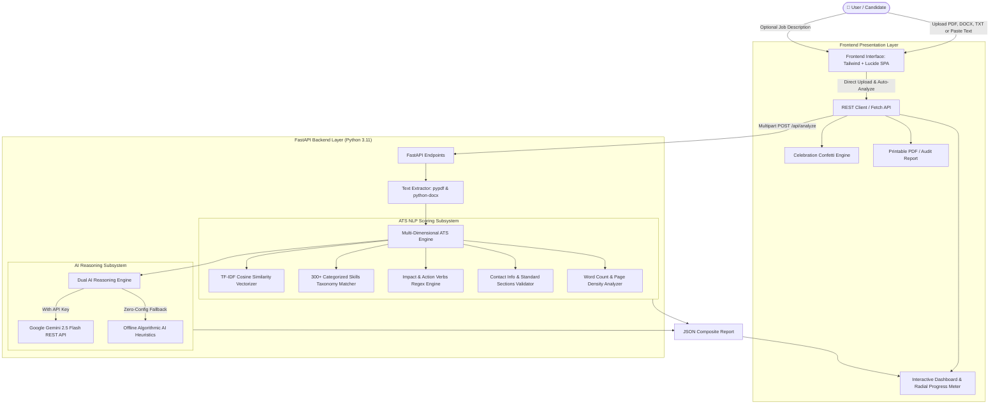

# 🚀 AI Resume & ATS Master

<p align="center">
  
  
  
  
  
  
  
</p>

---

## 📌 Overview

**AI Resume & ATS Master** is an intelligent recruitment preparation platform that analyzes resumes against applicant tracking systems and target job descriptions in real-time. Built with FastAPI, Scikit-Learn NLP, and Google Gemini AI, it delivers multi-dimensional scoring, instant skills gap detection, and Google XYZ-formula bullet rewrites to help job seekers land interviews.

Whether you upload a standalone resume for a general ATS health check or compare it against a specific job description, the platform provides actionable recruiter insights, quantifiable impact scoring, and tailored cover letters in seconds.

---

## 📸 Application Preview & Core Modules

```
+---------------------------------------------------------------------------------------------------+
|  [ResumeAI Pro 2.0]        [⚡ Quick Samples: SWE | AI/Data]     [✨ AI Settings]   [🖨️ Print Report] |
+---------------------------------------------------------------------------------------------------+
|                                                                                                   |
|     1. YOUR RESUME (PDF/DOCX/TXT)                   2. TARGET JOB DESCRIPTION (Optional)          |
|  +---------------------------------------+       +---------------------------------------------+  |
|  |  ☁️ Drag & drop resume here            |       | Paste role requirements, qualifications,    |  |
|  |     [Browse Computer]                 |       | and key responsibilities for targeted match |  |
|  |  ✓ resume.pdf (48.2 KB)               |       |                                             |  |
|  +---------------------------------------+       +---------------------------------------------+  |
|                                                                                                   |
|               [ 🚀 Analyze Resume & Calculate ATS Score (Instant on Upload) ]                     |
|                                                                                                   |
|  ===============================================================================================  |
|                                      EXECUTIVE SCORECARD                                          |
|  ===============================================================================================  |
|          (( 88% ))  Exceptional Target Match        • Keyword Relevance:   [████████░░] 84%       |
|          Top 5% Candidate Ranking                   • Skills Coverage:     [█████████░] 92%       |
|                                                     • Quantifiable Impact: [████████░░] 85%       |
|                                                     • Section Completeness:[██████████] 100%      |
|                                                     • Readability & Length:[█████████░] 95%       |
|                                                                                                   |
|  [Skills & Gap Analysis]  [AI Recruiter Verdict]  [Bullet Optimizer (XYZ)]  [Cover Letter]        |
|  -----------------------------------------------------------------------------------------------  |
|  ✅ Matched Skills:  [Python] [FastAPI] [Docker] [Kubernetes] [AWS] [PostgreSQL] [Redis]          |
|  ❌ Critical Gaps:   [Kafka] [Terraform]  --> (1-Click AI guidance on how to integrate into CV)   |
|                                                                                                   |
|  ⚡ Google XYZ Bullet Rewriter:                                                                   |
|  Original: "Worked on backend APIs and helped with database"                                      |
|  Rewritten: "Spearheaded FastAPI microservices redesign, reducing latency by 42% for 2.5M MAU"   |
+---------------------------------------------------------------------------------------------------+
```

---

## 🏗️ System Architecture



---

## ⚡ Scoring Dimensions & Formula

The composite ATS score ($0 - 100\%$) is calculated across five weighted dimensions:

$$\text{ATS Score} = (0.35 \times \text{Keywords}) + (0.25 \times \text{Skills}) + (0.20 \times \text{Impact}) + (0.10 \times \text{Structure}) + (0.10 \times \text{Formatting})$$

| Dimension | Weight | Description |
| :--- | :---: | :--- |
| **Keyword & Semantic Match** | `35%` | TF-IDF n-gram vectorization and cosine similarity against target job requirements. |
| **Hard & Soft Skills Coverage** | `25%` | Automated taxonomy match against 300+ technical, cloud, framework, and leadership skills. |
| **Quantifiable Impact & Verbs** | `20%` | Audits numbers, metrics (%, \$, scale), and flags passive verbs in favor of leadership action verbs. |
| **Sections & Contact Completeness** | `10%` | Validates presence of email, phone, LinkedIn, GitHub, summary, experience, education, and skills. |
| **Formatting & Readability** | `10%` | Analyzes word density sweet-spot ($450 - 850$ words) and page length estimates. |

---

## 🛠️ Quick Start & Local Setup

### 1. Prerequisites
- Python **3.10** or higher
- Git

### 2. Clone Repository
```bash
git clone https://github.com/your-username/ai-resume-ats-analyzer.git
cd ai-resume-ats-analyzer
```

### 3. Install Dependencies
```bash
pip install -r requirements.txt
```

### 4. Run the Application
**On Windows (1-Click):**
Double-click `run.bat` or execute:
```powershell
.\run.ps1
```

**Cross-Platform (macOS / Linux / Windows):**
```bash
python app.py
```

### 5. Access the Web App
- Open your browser to: **`http://127.0.0.1:8000`**
- Interactive OpenAPI / Swagger documentation: **`http://127.0.0.1:8000/docs`**

---

## 🌐 Free Cloud Deployment Guide

You can deploy and host this application for free on any major cloud platform:

### Option A: Deploy on Render (Recommended)
1. Fork or push this repository to your GitHub account.
2. Log in to [Render.com](https://render.com) and click **New + > Web Service**.
3. Connect your GitHub repository.
4. Render automatically detects `render.yaml` or use these settings:
   - **Environment:** `Python`
   - **Build Command:** `pip install -r requirements.txt`
   - **Start Command:** `uvicorn backend.main:app --host 0.0.0.0 --port $PORT`
   - **Instance Type:** `Free`
5. Click **Create Web Service**. Your app is live with a free HTTPS URL!

### Option B: Deploy on Railway
1. Go to [Railway.app](https://railway.app) and select **New Project > Deploy from GitHub repo**.
2. Select this repository. Railway automatically reads the `Procfile` and deploys.

### Option C: Deploy on Vercel
1. Install Vercel CLI: `npm i -g vercel`
2. Run `vercel` from the root directory. Vercel utilizes the provided `vercel.json` configuration.

---

## 🧪 1-Click Testing for Recruiters & Reviewers

In the top navigation bar, click either of the pre-loaded sample buttons:
- **`⚡ Software Eng`**: Loads a Senior Full-Stack Cloud Engineer resume against a Distributed Systems & AWS JD.
- **`⚡ AI / Data Science`**: Loads a Machine Learning Engineer resume against a Generative AI & RAG JD.

The application automatically parses, scores, and displays the complete results dashboard instantly.

---

## 🔒 Security & Privacy
- **Client-Side Storage**: Optional Google Gemini API keys are saved exclusively in your browser's local storage (`localStorage`).
- **Data Privacy**: Resumes are parsed in memory and are never persisted to external databases.

---

## 📄 License
Distributed under the **MIT License**. See `LICENSE` for details.
